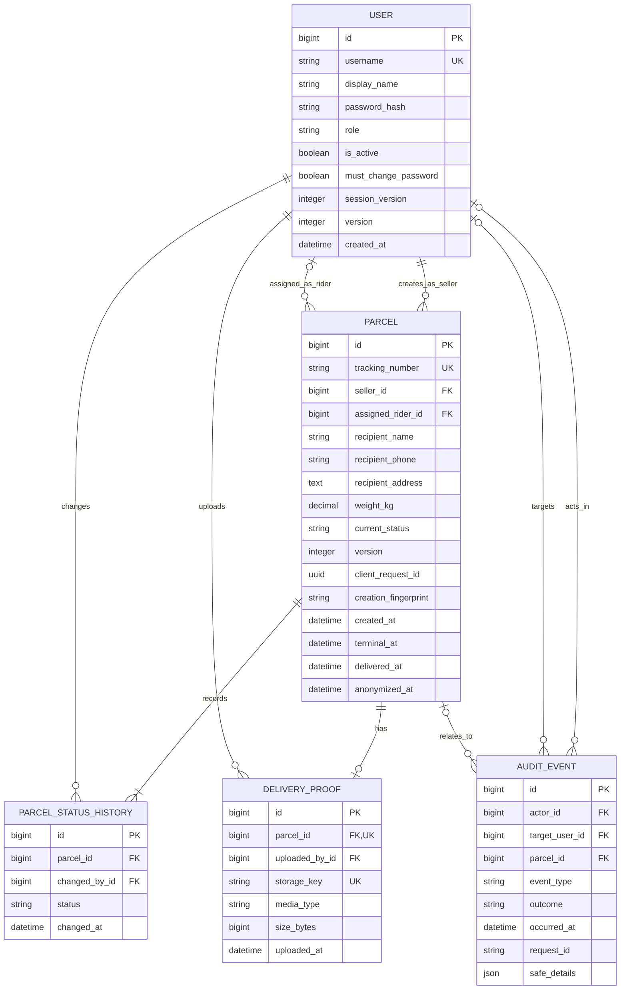

# ParcelTrack Lite initial ERD

Conceptual database design for team review. This is a draft, not an implemented database. The [shared system contract](shared/system-contract.md) defines authoritative field constraints and operations. Session, migration and rate-limit infrastructure is omitted from the business-entity diagram.

## Field and relationship rules

| Item | Rule |
| --- | --- |
| User roles | Seller, Rider and Admin only. Public tracking needs no User row. Public registration always creates a Seller, regardless of submitted role fields. |
| Password field | Logical hash field; use the framework's password storage API. Never keep plaintext passwords or a separate recoverable password value. |
| Seller ownership | Every parcel belongs to exactly one Seller. Read/search queries derive ownership from the logged-in user. Never accept a seller ID as authority from a submitted form. |
| Rider assignment | A parcel has zero or one current Rider. Only Admin may assign an active Rider. The nullable foreign key alone does not enforce the Rider role; application validation must. |
| Tracking number | Unique cryptographically random identifier, proposed minimum 128 random bits. Use a unique index and regenerate on collision. Do not derive it from parcel IDs, phone numbers or timestamps. |
| Weight | Positive decimal kilograms with documented precision and an agreed upper bound. Validate on the server and add a database check where supported. |
| Personal data | Name, phone and address are required at registration. Allow anonymization later without deleting the status history. Store phone values as strings. |
| Status history | Each parcel starts with Registered history in the same transaction as creation. Record each subsequent change with the acting User and timestamp. No public endpoint may return actor information. |
| Current status | Stored on Parcel for lists/counts. Update it and append history in the same database transaction. Lock the parcel during transitions so concurrent updates cannot create contradictory history. |
| Proof | Zero or one photo per parcel in this initial scope. Store only its private storage key and metadata in the database. The application must restrict who can retrieve it. |
| Final outcome | Proposed rule: Delivered and Failed require a valid proof photo. Commit the proof metadata and final status together; failure must not leave a final status without proof. |
| Audit | Actor is nullable for unauthenticated failures. Log a safe event category and outcome. Do not put submitted passwords, complete addresses or raw login payloads in this table. |
| Time | Store timezone-aware timestamps consistently and display Malaysia time in the demo. Public tracking returns only status, date and time. |

## Proposed allowed status transitions

| Current state | Next state | Authorized actor |
| --- | --- | --- |
| New parcel | Registered | Seller creating their own parcel |
| Registered | Assigned | Admin selecting an active Rider |
| Assigned | Out for Delivery | Assigned active Rider |
| Out for Delivery | Delivered | Assigned active Rider with a valid proof photo |
| Out for Delivery | Failed | Assigned active Rider with a valid proof photo |

Delivered and Failed are terminal. Admin may reassign unfinished Assigned or Out for Delivery parcels to another active Rider without changing status. Reassignment records an audit event with the Admin and old/new Rider IDs; it does not insert a duplicate status history event. First assignment creates Assigned history. Redelivery after a terminal outcome and replacing proof images are outside scope. Every assignment/status mutation checks the expected parcel version and increments it on a real change.

The case study lists these states and roles but does not fully specify retries, reassignment, proof replacement or all transition constraints. The table above makes an explicit implementation proposal.

## Privacy and retention

Public tracking must select only status and timestamp fields. Exclude recipient information, actor identity, internal user IDs and proof links from the entire public response, including hidden fields and embedded scripts.

At 12 months after delivery, the project's P3 policy requires deletion or anonymization of recipient data. Clear personal fields and remove identifying proof images while keeping non-identifying history. The implementation baseline also applies 12 months after terminal_at for Failed parcels as an explicit design choice. Deny photo access before retryable file deletion and follow the [backup retention/restore procedure](shared/integration-and-aws.md#backup-and-restore).

## Initial implementation decisions

- Use account disablement for departed Riders so history keeps a valid actor reference. Reject future requests from disabled accounts, including existing sessions.
- Restrict destructive account/parcel deletion where it would remove required history.
- Add indexes for tracking_number, seller_id, assigned_rider_id and parcel history ordering.
- Authorize proof downloads on the server. The shared contract proposes Admin, the parcel's Seller and its assigned Rider as readers. Public users receive no proof access. This is an explicit implementation rule because the brief specifies upload rights but not photo download rights.
- Keep database roles, validation and server-side authorization consistent. Foreign keys cannot establish ownership or authorization by themselves.

## PostgreSQL row level security design

The team selected PostgreSQL in Docker with RLS as the database direction. The entities above remain unchanged. Add policies and database privileges through versioned migrations; the following is design guidance, not implemented SQL.

| Application actor | Parcel read access | Allowed business operation |
| --- | --- | --- |
| Seller | Own parcels | Register own parcel; no assignment or delivery-status changes |
| Rider | Assigned parcels | Permitted status updates and proof submission for assigned parcels |
| Admin | All parcels | Assignment and dashboard; no Rider delivery-status updates |
| Public | No direct parcel-table access | Dedicated tracking lookup returning only status and timestamps for the supplied tracking number |

### Database roles and transactions

1. Separate the migration/owner role from runtime roles. The runtime role must not own protected tables, be a superuser, have BYPASSRLS, or inherit owner/bypass privileges. Do not connect the application as the default postgres administrator.
2. Enable and force RLS on protected parcel, history and proof-metadata tables. Specify policies for each operation, using USING for visible existing rows and WITH CHECK for permitted inserted/updated rows. Missing authenticated context must deny access. Avoid a broad permissive policy that accidentally grants access through OR composition.
3. Authenticate in the backend first. Open a transaction and set the verified application user ID and expected session_version using transaction-local, parameterized set_config calls. Policies derive role/active status and validate session version against app_user. All protected queries must use that same transaction and database connection. Never accept identity or role context from request parameters.
4. Use transaction-local settings so connection-pool reuse does not retain another user's context. Test successful commits and rollbacks. Framework lazy queries must not run outside the transaction that establishes identity.
5. Treat custom database settings as backend-supplied context, not an unforgeable credential. A runtime connection able to execute arbitrary SQL can potentially change those settings. Continue preventing SQL injection and protect database credentials; do not expose the connection directly to the browser.
6. Keep authentication bootstrap queries separate from parcel authorization context. Account login needs a narrowly scoped credential lookup before the user is authenticated; it must not establish broad anonymous parcel access.

PostgreSQL documents that superusers and BYPASSRLS roles bypass policies, and table owners normally do as well. FORCE RLS subjects ordinary owner access to policies but does not constrain superusers or BYPASSRLS roles. See [row security policies](https://www.postgresql.org/docs/current/ddl-rowsecurity.html). Transaction-local settings expire on commit or rollback: [SET documentation](https://www.postgresql.org/docs/current/sql-set.html).

### Row access and field permissions

RLS restricts rows, not individual columns or every business operation. A Rider who can update an assigned parcel must not thereby gain permission to rewrite recipient data, ownership or assignment. The selected baseline gives app_runtime protected SELECT access and EXECUTE on controlled create/assign/status/lock functions, with no direct parcel/history/proof DML or privileged row locking. Non-login domain_writer owns those functions, has specific DML grants, and remains subject to RLS. Functions and backend services both check actor/session version, field allowlists, transitions and expectedVersion. All privileged functions use the shared hardening rules. See the [authoritative privilege design](shared/system-contract.md#rls-and-database-privileges).

History access and proof-metadata access must follow the parent parcel's ownership/assignment. History writes must record the verified actor and be append-only for ordinary runtime operations. Review policy dependencies to avoid recursive policy queries and ensure legitimate inserts/history updates work under the runtime role.

### Public tracking

Use the separate tracking_runtime pool/role that can execute only lookup_tracking. The function matches one supplied tracking token and returns only status and timestamps, with no recipient fields, actor IDs or proof links. The caller has no general access to Parcel or history tables. Its non-login function owner has restricted column grants and explicit read policies, never superuser or BYPASSRLS.

lookup_tracking is a SECURITY DEFINER function owned by the narrowly privileged non-login lookup role. Like every other privileged function, it uses a trusted fixed search_path with pg_temp last and qualified references; creation, PUBLIC revocation and narrow EXECUTE grants occur in one migration transaction. Review this deliberate read boundary separately; it must not accept arbitrary SQL. Apply lookup rate limits in the backend. A public view alone does not guarantee caller-RLS behavior or token-scoped access.

Keep the database private within the Docker network in cloud. Persist its data in a named volume and maintain separate backups. For a local database GUI, bind any published database port to localhost only.
