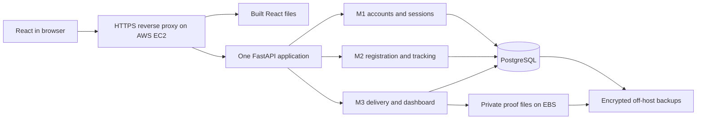

# ParcelTrack Lite complete project plan

Planning baseline agreed on 21 October 2026: React frontend, FastAPI backend, PostgreSQL with RLS, Docker Compose, and AWS hosting. This is an implementation plan. It does not claim application code, tests or deployment are complete.

## Plans by owner

| Owner | Independent module plan | Scope |
| --- | --- | --- |
| NASZ | [M1 Login and User Management](modules/module-1-auth/README.md) | Accounts, sessions, permissions, password change and user administration |
| Zikri | [M2 Parcel Registration and Public Tracking](modules/module-2-parcels/README.md) | Parcel creation, seller access/search and privacy-preserving tracking |
| Qee | [M3 Delivery Update and Admin Dashboard](modules/module-3-delivery/README.md) | Assignment, delivery outcomes, proof handling and dashboard |

Each owner delivers their module's backend, React screens, migrations, security tests and demonstration. The group delivers one integrated application, not three applications.

Read the [shared system contract](shared/system-contract.md) before implementation. It is authoritative for API paths, payloads, status values, permissions and transaction rules. The [integration and AWS plan](shared/integration-and-aws.md) defines the release sequence and shared completion gates. [Initial ERD](initial-erd.md) and [security test worksheet](security-tests.md) support these plans.

The [automated testing strategy](shared/testing-strategy.md) defines unit, component, real-PostgreSQL/API integration, browser and deployment/recovery suites, with coverage gates and a mapping for all 14 features. [Independent review resolutions](review-resolutions.md) record gaps found and addressed before implementation.

## Product boundary

The completed system covers every function in case-study sections 4 and 5: Seller registration and accounts; Seller parcel registration and own-parcel search; public status tracking; Admin user management and Rider assignment; assigned Rider updates and one proof image; and Admin counts for all five statuses. It also enforces policies P1 to P5 and provides a cloud demonstration and security test record for each member.

Payments, courier integrations, maps/GPS, notifications, a mobile app, account recovery by email, multiple proof images, redelivery after a final outcome and multiple organizations are outside this scope. Excluding them does not remove a listed case-study function. Reassignment of an unfinished parcel is included so disabling a departed Rider cannot strand delivery work.

## Single architecture

React never connects directly to PostgreSQL. RLS complements backend authorization. The public tracking database connection has a separate restricted role. All module endpoints share /api/v1 and one frontend session.

## Shared ownership

| Work | Coordinator | Required collaboration |
| --- | --- | --- |
| FastAPI entry point, session/CSRF dependencies, shared API client and route guards | NASZ | Zikri and Qee consume the same contracts |
| Schema ordering, Alembic revision integration, RLS context helper and shared data types | Zikri | Each owner writes their own module migrations and policies; all review grants |
| Proof storage, retention file cleanup and backup/restore procedure | Qee | Zikri supplies retention candidates; NASZ supplies scheduled-job identity |
| Docker, CI and AWS release integration | NASZ | Zikri verifies database/RLS; Qee verifies private files and restoration |
| ERD, common layout and final acceptance | All three | One review of each module plus the complete cloud journey |

Coordinating integration does not transfer ownership of another member's assessed code. API/schema changes require updates to the shared contract and affected module plans in the same PR.

## Implementation order

| Stage | Work | Exit condition |
| --- | --- | --- |
| P0 Foundation | Repository skeleton, Docker/PostgreSQL, schemas, synthetic fixtures, role/status constants and response types | Clean checkout starts locally, migrations apply, runtime roles cannot bypass RLS |
| P1 Checkpoint slices | M1 login/protected page; M2 registration saved to database; M3 assigned parcel moved to Out for Delivery | Three small working demonstrations using the same database and session |
| P2 Full functionality | All module functions and screens, public tracking, assignment/reassignment, final outcomes/photo and password/user administration | Integrated successful and Failed journeys both work |
| P3 Security and recovery | Complete backend authorization, RLS, CSRF, rate limits, upload defenses, retention and failure handling | All required security cases pass with recorded evidence |
| P4 AWS release | EC2 HTTPS deployment, private PostgreSQL, durable storage, backups, restore and smoke tests | All roles work on the live URL and data survives restart/redeploy |
| P5 Final submission | Final evidence matrix, individual explanations, 30-minute rehearsal and unresolved-issue review | Each member can demonstrate and explain their own module and blocked attacks |

P1 is the 22 October checkpoint target, not the whole-project definition of done. Source documents set the final submission at Week 14; no invented calendar date is assigned here. Later stages can overlap, but a module is not complete until its own acceptance criteria and the shared release gates pass.

Write and run tests with each feature from P0 onward. Authentication, authorization, input validation, safe session handling and basic RLS are part of the first working slices; P3 expands/verifies them rather than postponing all security until later. No unfinished slice is exposed publicly without its required access and privacy controls.

## Whole-project completion criteria

- [ ] All feature IDs in the three module plans have working UI and API evidence.
- [ ] The single role matrix is enforced on direct requests, not only navigation.
- [ ] RLS tests run under deployed runtime credentials and include connection reuse/rollback.
- [ ] Successful and Failed workflows preserve current status, history and proof consistency.
- [ ] User disablement blocks old sessions and unfinished work can be reassigned.
- [ ] All security worksheet rows have actual results, safe evidence and owner names; each member covers more than five distinct input types.
- [ ] Retention, incident handling, backups and restoration have documented and exercised procedures.
- [ ] A clean checkout and cloud deployment are reproducible with migrations and supplied secret configuration.
- [ ] HTTPS cloud demo works for Seller, Rider, Admin and public users; local-only delivery is not the planned finish.
- [ ] No real recipient data, usable test passwords or deployment secrets are committed.
- [ ] Each member can explain their own code and security decisions in the final demonstration.
- [ ] Unit/component, API/PostgreSQL and core browser suites pass the testing strategy gates, with operational restore/maintenance evidence before cloud release.
- [ ] NASZ submits the lecturer's module allocation sheet by Week 5 with all full names/matric numbers and the starter-kit declaration if applicable; retain submission evidence and record status. Submission has not been verified in this task.

## Remaining decisions and external dependencies

1. FastAPI and PostgreSQL replace the frameworks/databases explicitly named in the brief. The user selected them; record this variation with the lecturer rather than assuming acceptance has been granted.
2. AWS account access, region, domain and instance budget need actual values before provisioning. No AWS resources have been created by this planning work.
3. NASZ needs to apply the prepared PR-only branch protection with repository administration access. The connected account previously could not apply it.
4. Full names and matric numbers are needed for the lecturer's allocation sheet and test document.

Proof read access, Failed-parcel retention, operational limits and reassignment rules are explicit design choices in the shared contract. They are the implementation baseline unless the group changes that contract through review; they are not claims that the lecturer specified those details.

## Requirement coverage

| Source | Plan coverage |
| --- | --- |
| Case study 4.1 | M1-F01 through M1-F05 |
| Case study 4.2 | M2-F01 through M2-F04 |
| Case study 4.3 | M3-F01 through M3-F05 |
| Case study 5 access matrix | Shared authorization and API tables |
| Case study 8 threats and 9 policies | Module security sections, RLS design, security worksheet and operational runbook |
| Rubric deployment/integration | P4 and shared release gates |
| Rubric security testing and demonstration | Per-module acceptance, evidence worksheet and P5 |

Reference documents are included at the repository root: ParcelTrack_Lite_Case_Study.docx, Rubric_Project_STTCK3033_ParcelTrack_Lite (1).docx and ParcelTrack Lite Project Briefing.pptx. This plan covers their final-project scope; [checkpoint preparation](checkpoint-plan.md) covers tomorrow's reporting separately.
