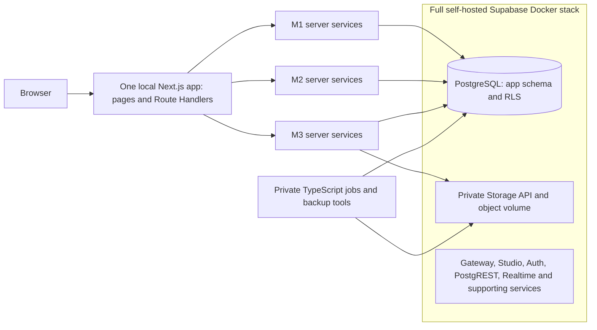

# Shared architecture, contracts and gates

This folder holds the cross-module material: the single architecture, the authoritative contract, phase and gate definitions, handoffs, integration tests and operations plans. Module-specific plans live in [docs/modules](../modules). The Next.js/Supabase implementation is planned; the separate React checkpoint prototype already exists and has frontend-only evidence.

## One authoritative home for each topic

| Topic | Authoritative document | Other documents may |
| --- | --- | --- |
| Roles, statuses, DTOs, endpoints, permissions, limits, error codes, database privileges, function signatures, proof and retention rules | [system-contract.md](system-contract.md) | link and summarize, never redefine |
| Phases PH1-PH6, identifiers, milestone matrix, group gates G1-G6 | [phase-framework.md](phase-framework.md) | cite phase and gate IDs |
| Handoffs H01-H61, temporary substitutes TMP-01-TMP-06, migration order, independent versus blocked work | [dependency-matrix.md](dependency-matrix.md) | cite IDs |
| Integration scenarios INT-CP-01 to INT-12 | [integration-tests.md](integration-tests.md) | cite IDs |
| Six end-to-end workflows by phase | [workflow-trace.md](workflow-trace.md) | cite |
| Requirement to phase to task to test mapping | [traceability.md](traceability.md) | extend only here |
| Source requirements, team decisions, proposed choices, external dependencies | [decision-register.md](decision-register.md) | cite D-nn, EXT-nn, SRC-nn |
| What each member starts with | [execution-sequence.md](execution-sequence.md) | cite |
| Test layers, tooling, fixtures, CI gates, evidence | [testing-strategy.md](testing-strategy.md) | cite |
| Local Supabase setup, later deployment, backup, restore and incident process | [integration-and-deployment.md](integration-and-deployment.md) | cite |
| Conceptual ERD and RLS design | [../initial-erd.md](../initial-erd.md) | cite |
| Security test rows (51) and evidence rules | [../security-tests.md](../security-tests.md) | cite |
| Per-module scope, phased tasks, tests | [docs/modules/*](../modules) | cite |

The checker `tools/check_plan_docs.py` verifies links, anchors, identifier definitions and references, handoff phase ordering, the 12-section phase template and the generated test indexes. Run it before merging any documentation change.

## Single architecture

Immediate target: localhost development and integration, followed by local production-build verification. Cloud hosting is a later PH5 decision. Next.js Client Components never connect to PostgreSQL or receive privileged Supabase keys. Server Components and Route Handlers share authorized server services; schema `app` is not exposed through public Supabase APIs. Full Supabase Docker is required infrastructure, with the existing custom username/session model retained as the only application login authority. [Local setup](../local-development.md) and [system contract](system-contract.md).

One application, one npm lockfile, one SQL migration history and one database. Full infrastructure does not mean duplicating business logic in Edge Functions, PostgREST or a separate Python backend.

## Shared ownership

| Work | Coordinator | Required collaboration |
| --- | --- | --- |
| Next.js shell, Route Handler composition, server auth/CSRF, client session provider, CI and private runner | Naszrul | Both module owners use the same session/error/validation contracts |
| Supabase PostgreSQL app-role bootstrap, ordered SQL migrations, pg transactions, RLS and grant verification | Zikri | Each owner authors module migrations; preserve vendor schemas/roles |
| Full-stack test harness, Playwright fixtures, private Supabase Storage adapter, matching backup/restore | Syauqi | Zikri supplies retention SQL; Naszrul supplies scheduler/auth boundaries |
| Full Supabase Compose setup and pinned upstream provenance | Naszrul with Zikri and Syauqi | Gateway/Studio exposure, DB roles and persistent Storage checked together |
| ERD, common layout, contract changes, local acceptance and later cloud decision | All three | Each member owns their module's UI, server logic, migrations, tests and explanation |

Coordinating shared work does not transfer assessed code ownership. Cross-module service calls stay inside the same server process; browser calls use the existing same-origin API contracts.
