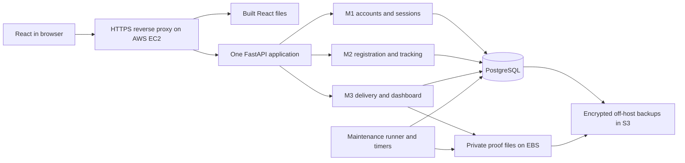

# Shared architecture, contracts and gates

This folder holds the cross-module material: the single architecture, the authoritative contract, phase and gate definitions, handoffs, integration tests and operations plans. Module-specific plans live in [docs/modules](../modules). All of it is planning; no code, infrastructure or test result exists yet.

## One authoritative home for each topic

| Topic | Authoritative document | Other documents may |
| --- | --- | --- |
| Roles, statuses, DTOs, endpoints, permissions, limits, error codes, database privileges, function signatures, proof and retention rules | [system-contract.md](system-contract.md) | link and summarize, never redefine |
| Phases PH1-PH6, identifiers, milestone matrix, group gates G1-G6 | [phase-framework.md](phase-framework.md) | cite phase and gate IDs |
| Handoffs H01-H61, temporary substitutes TMP-01-TMP-06, migration order, independent versus blocked work | [dependency-matrix.md](dependency-matrix.md) | cite IDs |
| Integration scenarios INT-CP-01 to INT-12 | [integration-tests.md](integration-tests.md) | cite IDs |
| Six end-to-end workflows by phase | [workflow-trace.md](workflow-trace.md) | cite |
| Requirement to phase to task to test mapping | [traceability.md](traceability.md) | extend only here |
| Source requirements, team decisions, proposed choices, external dependencies | [decision-register.md](decision-register.md) | cite D-nn, EXT-nn, SRC-nn |
| What each member starts with | [execution-sequence.md](execution-sequence.md) | cite |
| Test layers, tooling, fixtures, CI gates, evidence | [testing-strategy.md](testing-strategy.md) | cite |
| Deployment, AWS, backup, restore, incident process | [integration-and-aws.md](integration-and-aws.md) | cite |
| Conceptual ERD and RLS design | [../initial-erd.md](../initial-erd.md) | cite |
| Security test rows (51) and evidence rules | [../security-tests.md](../security-tests.md) | cite |
| Per-module scope, phased tasks, tests | [docs/modules/*](../modules) | cite |

The checker `tools/check_plan_docs.py` verifies links, anchors, identifier definitions and references, handoff phase ordering, the 12-section phase template and the generated test indexes. Run it before merging any documentation change.

## Single architecture

React never connects directly to PostgreSQL. RLS complements backend authorization. The public tracking database connection uses a separate restricted role that can only execute `lookup_tracking`. The maintenance runner (retention, reconciliation, cleanup, backups) has no HTTP entry point and its own credential. All module endpoints share `/api/v1` and one frontend session. There is one frontend, one backend application and one database; each member owns their module's code, migrations, tests, security controls and demonstration.

## Shared ownership

| Work | Coordinator | Required collaboration |
| --- | --- | --- |
| Repository skeleton, FastAPI entry point, session/CSRF dependencies, API client, route guards, maintenance runner, CI skeleton, AWS stack and release | NASZ | Zikri and Qee consume the same contracts |
| Role bootstrap, Alembic chain, function-hardening template and lint, RLS context helper, constants, fixture loader, grants snapshot | Zikri | Each owner writes their own module migrations and policies; all review grants |
| Test harness, Playwright and file fixtures, proof storage, backup coordination, backup/restore, retention file cleanup | Qee | Zikri supplies retention candidates; NASZ supplies scheduler identity |
| ERD, common layout, contract changes and final acceptance | All three | One review of each module plus the complete cloud journey |

Coordinating shared work does not transfer ownership of another member's assessed code. API/schema changes require updates to the contract, the affected phase files and tests in the same PR.
