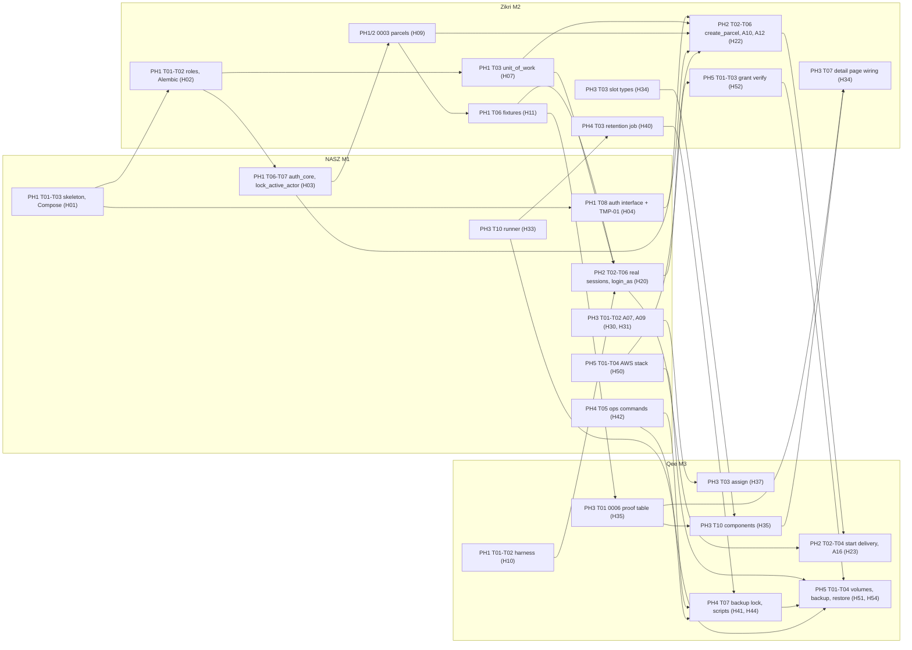

# Dependency matrix, handoffs and temporary substitutes

Status: reviewable plan. Task IDs refer to the [module phase files](../modules); test IDs refer to cases in those files and to [integration scenarios](integration-tests.md). Nothing here is implemented.

Reading rule: a handoff `Hnn` is "delivered" when the producer's task is merged **and** the proving test passes **and** at least one consumer confirms in the PR that they used it from their own branch. A consumer may start earlier using the listed temporary substitute.

Example of a concrete dependency: Zikri's protected parcel-registration endpoint (M2-PH2-T03) depends on NASZ's authentication interface (H04, M1-PH1-T08) and, once real, the active-principal, session and CSRF dependencies (H20, M1-PH2-T03 and T06), on `principal_uow` (M1-PH2-T08, which wraps Zikri's own H07, M2-PH1-T03), and on the `lock_active_actor` database function (H03, M1-PH1-T07) that his `create_parcel` calls. Until H20, his tests use TMP-01; TMP-01 is retired by M1-PH2-T09.

## Principles that keep the graph acyclic

1. Contracts first: error envelope, `Principal`, constants, DTOs, role names, migration order and function signatures are PH1 deliverables ([contract v3](system-contract.md#contract-v3-amendments)). Everything built later consumes them.
2. Controlled fixtures early: the fixture loader (H11) and harness (H10) exist before any slice, so no module waits for another module's UI to obtain test data.
3. Database layers are strictly ordered (below). A later layer may reference an earlier one, never the reverse.
4. Where two owners need each other's output (the parcel detail page and the Rider panel), the dependency is split into a types-only contract (earlier) and an implementation (later), so no cycle remains at task level.
5. Temporary substitutes are labeled, time-boxed and retired by a named task with a proving test.

## Migration and layer order

| Order | Revision | Owner | Depends on | Notes |
| --- | --- | --- | --- | --- |
| 0 | Cluster role bootstrap script (not a revision) | Zikri M2-PH1-T01 | PostgreSQL running (M1-PH1-T03) | Operator credential; never in services |
| 1 | `0001_bootstrap_schema` | Zikri M2-PH1-T02 | Role bootstrap | Schema, default privileges, hardening template |
| 2 | `0002_auth_core` (account tables, `system_state`, foundation functions `lock_active_actor` and `get_login_snapshot`) | NASZ M1-PH1-T06, T07 | 0001, function-owner roles | `audit_event.parcel_id` is plain bigint here |
| 3 | `0003_parcels` (tables, RLS, all runtime-role and owner-role policies, grants, `audit_event.parcel_id` FK) | Zikri M2-PH1-T05 | 0002 | Complete in PH1; M2-PH2-T01 only verifies it |
| 4 | `0004_create_parcel` | Zikri M2-PH2-T02 | 0003 | Own revision so 0003 is never edited |
| 5 | `0005_delivery_functions` (`update_delivery_status`, start branch) | Qee M3-PH2-T02 | 0004 | Uses grants and policies already in 0003 |
| 6 | `0006_delivery_proof` (table, policies, grants) | Qee M3-PH3-T01 | 0005 | Merged first in PH3; Zikri reviews the policy SQL |
| 7 | `0007_delivery_final` (`assign_parcel`, `lock_delivery_target`, final branch, reconcile helper) | Qee M3-PH3-T01 | 0006 | Second step of the same task |
| later | `tracking_lookup`, `retention_functions` (Zikri); `proof_maintenance_functions` (Qee); `account_functions`, `session_cleanup_functions`, `ops_functions` (NASZ) | owner of the function | 0007 | Additive; single head enforced by Zikri |

## Handoff register

| ID | Producer | Consumer(s) | Delivered by (task) | Needed by (tasks) | Proving test | Substitute until delivered |
| --- | --- | --- | --- | --- | --- | --- |
| H01 | NASZ | Zikri, Qee | M1-PH1-T01, T02, T03 | M2-PH1-T02, T03; M3-PH1-T01, T02 | M1-PH1-TC11 | Throwaway local PostgreSQL |
| H02 | Zikri | NASZ, Qee | M2-PH1-T01, T02 | M1-PH1-T06, T07; M3-PH1-T01, T07 | M2-PH1-TC01, TC02, TC03 | Superuser throwaway DB for drafting only; not mergeable |
| H03 | NASZ | Zikri, Qee | M1-PH1-T06, T07 | M2-PH1-T05; M2-PH2-T02; M3-PH1-T06, T07; M3-PH2-T02 | M1-PH1-TC05, TC06 | Draft 0003/0004/0005 on branches |
| H04 | NASZ | Zikri, Qee | M1-PH1-T08 | M2-PH2-T03; M3-PH2-T03, T04 | M1-PH1-TC07 | The interface plus TMP-01 is the substitute |
| H05 | NASZ | Zikri, Qee | M1-PH1-T04, T05 | every endpoint task (M2-PH2-T03, M3-PH2-T03) | M1-PH1-TC01, TC02, TC13 | Local copies are not allowed |
| H06 | NASZ | Zikri, Qee (frontend) | M1-PH1-T09 | M2-PH2-T05; M3-PH2-T05 | M1-PH1-TC08, TC09, TC10 | TMP-03 |
| H07 | Zikri | NASZ, Qee | M2-PH1-T03 | M1-PH2-T08; M2-PH2-T01, T03; M3-PH2-T03 | M2-PH1-TC04 | Fake unit of work in unit tests only |
| H08 | Zikri | NASZ, Qee | M2-PH1-T04 | M1-PH1-T06; M3-PH1-T03, T07 | M2-PH1-TC05 | Contract table copied, replaced before G1 |
| H09 | Zikri | NASZ, Qee | M2-PH1-T05 | M3-PH1-T07; M3-PH2-T02 | M2-PH1-TC06 | Draft SQL on branch |
| H10 | Qee | NASZ, Zikri | M3-PH1-T01, T02 | M1-PH2-T09, T12; M2-PH2-T09; M3-PH2-T07 | M3-PH1-TC01, TC05 | Ad-hoc fixtures, not carried to G2 |
| H11 | Zikri | NASZ, Qee | M2-PH1-T06 | M1-PH2-T01; M3-PH2-T01 | M2-PH1-TC07 | Provisioner SQL seed, uncommitted passwords |
| H12 | Zikri | Qee | M2-PH1-T07 | M3-PH2-T04 | M2-PH1-TC08 | Local DTOs forbidden; generated TypeScript types stay empty until routes exist |
| H13 | Qee | NASZ, Zikri | M3-PH1-T04, T06, T08 | M1-PH3-T10; M2-PH4-T03 | M3-PH1-TC04, TC06, TC08 | No-op lock interface in runner |
| H14 | NASZ | Zikri, Qee | M1-PH1-T10 | M2-PH1-T06; M1-PH2-T01 | M1-PH1-TC04 | Precomputed test hashes (uncommitted) |
| H20 | NASZ | Zikri, Qee | M1-PH2-T02 to T06, T09 | M2-PH2-T03, T09; M3-PH2-T03, T07 | M1-PH2-TC01, TC06, TC16 and INT-CP-01 | TMP-01, TMP-04 |
| H21 | NASZ | Zikri, Qee | M1-PH2-T04, T07 | M2-PH3-T05; M2-PH4-T06; M3-PH3 audit use | M1-PH2-TC05, TC12 | none |
| H22 | Zikri | Qee, group | M2-PH2-T02, T03, T06 | M3-PH2-T05; INT-CP-01 | M2-PH2-TC01, TC10 | Placeholder detail link |
| H23 | Qee | NASZ, Zikri, group | M3-PH2-T02, T03, T04 | INT-CP-01; M1-PH3-TC08 | M3-PH2-TC01, TC02 | none |
| H24 | NASZ | Zikri, Qee | M1-PH2-T12 | M2-PH2-T07 (TC15); M3-PH2-TC10 | M1-PH2-TC18 | Rows kept in module tests |
| H25 | Zikri | Qee | M2-PH2-T01, T08 | M3-PH2-T01 | M2-PH2-TC16 | Fixture hook agreed in PH1 |
| H30 | NASZ | Qee | M1-PH3-T01 | M3-PH3-T03, T09 | M1-PH3-TC12, M3-PH3-TC12 | TMP-05 |
| H31 | NASZ | Qee | M1-PH3-T02 | M3-PH3-T11; M3-PH4-T05 | M1-PH3-TC11, M3-PH3-TC15 | Direct database disablement in tests |
| H32 | NASZ | Zikri, Qee | M1-PH2-T06 (gate in `require_authenticated`), M1-PH3-T05 (full set) | M2-PH2-T03; M3-PH2-T03, T04 | M1-PH3-TC08, M3-PH2-TC06 | Probe route |
| H33 | NASZ | Zikri, Qee | M1-PH3-T10 | M2-PH4-T03; M3-PH4-T02, T04 | M1-PH3-TC19 | Jobs invoked directly |
| H34 | Zikri | Qee | M2-PH3-T03 (slot types) | M3-PH3-T10 | M2-PH3-TC11 | Own wrapper page, removed before G3 |
| H35 | Qee | Zikri | M3-PH3-T01 (table), M3-PH3-T10 (components) | M2-PH3-T03, T07 | M3-PH3-TC11, TC13 | `hasProof` false; placeholder components |
| H36 | Zikri | Qee | M2-PH3-T08 | M3-PH4-T04 | M2-PH3-TC12, TC13 | Direct function calls in tests |
| H37 | Qee | NASZ, Zikri | M3-PH3-T03, T04 | M2-PH3-T09; E2E specs | M3-PH3-TC01, TC17 | TMP-02 |
| H38 | Qee | Zikri | M3-PH3-T12 | M2-PH3-T09 | M3-PH3-TC18 | Qee-owned proof profile files |
| H39 | Zikri | Qee, group | M2-PH3-T07 (detail page wiring) | M3-PH3-T14 | M2-PH3-TC11, M3-PH3-TC14 | Wrapper page |
| H40 | Zikri | Qee | M2-PH4-T03 | M3-PH4-T04 (end-to-end leg of TC04 only; the purge job itself needs H36) | M2-PH4-TC12, TC13 | `anonymize_parcel` called directly |
| H41 | Qee | NASZ, Zikri | M3-PH4-T07 (lock, maintenance mode) | M1-PH4-T06; M2-PH4-T03 | M3-PH4-TC07, TC15 | No-op interface from H13 |
| H42 | NASZ | Qee, Zikri | M1-PH4-T05 | M3-PH4-T07; M3-PH5-T04; M2-PH5-T05 | M1-PH4-TC10, TC11 | Manual SQL on a throwaway restore |
| H43 | Zikri, Qee | NASZ | M2-PH4-T11, M3-PH4-T11 | M1-PH4-T01 | M1-PH4-TC01 | Rows from PH2/PH3 tests |
| H44 | Qee | NASZ, Zikri | M3-PH4-T07 (backup and restore scripts) | restore verification M1-PH4-TC11, M2-PH4 (post-restore checks), M3-PH5-T04 | M3-PH4-TC07 | Manual dump/restore |
| H45 | Zikri | NASZ, Qee | M2-PH4-T01 (grants snapshot, catalog tests) | M3-PH4-T07; M1-PH4-T12 | M2-PH4-TC02 | Role listings checked by hand |
| H46 | Qee | Zikri, NASZ | M3-PH4-T04 (proof purge job) | M2-PH4-T03 (end-to-end leg of TC13) | M3-PH4-TC04 | Purge function called directly |
| H50 | NASZ | Zikri, Qee | M1-PH5-T01 to T04 | M2-PH5-T01; M3-PH5-T01 | M1-PH5-TC01, TC06 | Local production-like Compose |
| H51 | Qee | NASZ, Zikri | M3-PH5-T01 to T03 | M2-PH5-T02, T04; M1-PH5-T08 | M3-PH5-TC01, TC02, TC03 | Named volumes for rehearsal |
| H52 | Zikri | NASZ, Qee | M2-PH4-T01 (bootstrap invocation and `verify_grants` scripts), M2-PH5-T03 (run under deployed credentials) | M1-PH5-T04; M3-PH5-T04 | M2-PH5-TC02, TC04 | PH4 local checks |
| H53 | NASZ | Zikri | M1-PH5-T12 | M2-PH5-T07 | M1-PH5-TC04 | Socket address (not release-grade) |
| H54 | Qee | NASZ, Zikri | M3-PH5-T04 | M1-PH5-T08; M2-PH5-T05 | M3-PH5-TC04 | PH4 local drill |
| H60 | NASZ, Zikri, Qee | group | M1-PH6-T02, M2-PH6-T02, M3-PH6-T02 | M1-PH6-T08, M2-PH6-T08, M3-PH6-T08 | M1-PH6-TC02, M2-PH6-TC02, M3-PH6-TC02 | none |
| H61 | NASZ | group | M1-PH6-T06 | G6 item 4 | M1-PH6-TC05 | Record "unverified" |

## Temporary substitutes

| ID | What | Introduced by | Allowed in | Must be retired by | Proof of retirement |
| --- | --- | --- | --- | --- | --- |
| TMP-01 | Test principal injected through `dependency_overrides` in the test app factory (no header or cookie switch; production factory has none) | M1-PH1-T08 | PH1 to early PH2 | M1-PH2-T09 | M1-PH2-TC16 (static guard) and permanently M1-PH1-TC07 (production refuses) |
| TMP-02 | Seeded ASSIGNED parcels inserted by the test provisioner instead of real assignment | M2-PH2-T08, M3-PH2-T01 | PH2 | M3-PH3-T04 | M3-PH3-TC17 |
| TMP-03 | Frontend MSW mock handlers for unfinished endpoints, included only in dev/test bundles | M1-PH1-T09 | PH1 to PH3 | Each owner for their own screens: M1-PH3-T09 (auth), M2-PH3-T07 (parcels and tracking), M3-PH3-T09 and T10 (delivery); checked together before G3 | Browser journeys M1-PH3-TC17 and M3-PH3-TC14 run without mocks; production bundle excludes mocks (build assertion) |
| TMP-04 | Provisioner inserts a real session row so slice tests can authenticate before A03 exists | M3-PH1-T01 | early PH2 | M1-PH2-T09 | M1-PH2-TC16 |
| TMP-05 | Static Rider list in the assignment dialog before A07 | M3-PH3-T09 | early PH3 | M1-PH3-T01 consumed in M3-PH3-T09 | M3-PH3-TC12 |
| TMP-06 | Permanent, test-only direct DML seeding by `fixture_provisioner` for states that are slow to reach through real flows | M2-PH1-T06 | all phases, tests only | not retired; guarded | M2-PH1-TC07 (refuses production); E2E journeys must use real flows (M3-PH3-TC17) |

## What can proceed independently, and what is blocked

"Independent" means startable now using only the contract and earlier deliverables. "Blocked" names the handoff. Group gate in the last column must pass before the next phase's tasks are declared complete.

| Phase | Independent (start immediately) | Blocked by | Gate |
| --- | --- | --- | --- |
| PH1 | NASZ: M1-PH1-T01 to T05, T10, T11, T13. Zikri: M2-PH1-T01, T02, T04, T08. Qee: M3-PH1-T01 (minimal), T03, T04, T05, T06 | M1-PH1-T06, T07 wait for H02 (M2-PH1-T01, T02). M2-PH1-T05 merge waits for H03. M2-PH1-T06 waits for H14 and T05. M3-PH1-T07 waits for H09. M3-PH1-T03 uses H08 (contract copy until then) | G1 |
| PH2 | NASZ: M1-PH2-T02, T04, T07 (pure services). Zikri: M2-PH2-T01, T02 (database). Qee: M3-PH2-T02 (function) once 0003 merged | M1-PH2-T01 waits for H11, H14. M1-PH2-T08 waits for H07. M2-PH2-T03 waits for H04 and later H20. M3-PH2-T01 waits for H25. M3-PH2-T05 waits for H06 and H22. All slice tests wait for H10 | G2 |
| PH3 | NASZ: M1-PH3-T01 to T07, T10. Zikri: M2-PH3-T01, T02, T04, T08. Qee: M3-PH3-T01 (first), T02, T05, T08 | M3-PH3-T03, T09 wait for H30/H31 (TMP-05 meanwhile). M2-PH3-T03 `hasProof` and M2-PH3-T07 slots wait for H35. M3-PH3-T10 waits for H34 types. M2-PH3-T09 waits for H37, H38 | G3 |
| PH4 | NASZ: M1-PH4-T02, T04, T05, T07, T08, T11. Zikri: M2-PH4-T01, T02, T06, T08. Qee: M3-PH4-T01, T03, T06, T08, T09, T10 | M1-PH4-T01 waits for H43 rows. M1-PH4-T06 waits for H41 and H36. M3-PH4-T04 waits for H40. M3-PH4-T07 waits for H42. M2-PH4-T03 waits for H33, H13 | G4 |
| PH5 | NASZ: M1-PH5-T02, T03, T05, T07, T10 (files and GitHub settings). Zikri: M2-PH5-T01 scripts, T06 (local). Qee: M3-PH5-T02 policies, T06 plan | All cloud execution waits for EXT-04 and M1-PH5-T01. M2-PH5-T07 waits for H53. M1-PH5-T08, M2-PH5-T05 wait for H54. M1-PH5-T04 needs the PH4 scripts of H52, not the cloud run | G5 |
| PH6 | Evidence compilation per module | M*-PH6-T08 waits for H60 from all three; every task waits for G5 | G6 |

## Dependency diagram (main chains)

The diagram shows the longest chains only; the register above is exhaustive. The detail-page contract is drawn as three nodes: slot types (Zikri, M2-PH3-T03) feed Qee's components (M3-PH3-T10), and Zikri's page wiring (M2-PH3-T07) consumes the finished components and the proof table, so no task depends on itself.

## Cycle and conflict checks

| Potential cycle | Break |
| --- | --- |
| M1 needs M2's roles and `unit_of_work`; M2 needs M1's `app_user` | Order: role bootstrap (Zikri) before 0002 (NASZ) before 0003 (Zikri); `unit_of_work` takes plain `(user_id, session_version)` so it does not need M1's `Principal` type; `principal_uow` is a thin NASZ wrapper delivered in PH2 |
| `audit_event` (M1) references `parcel` (M2) while parcel inserts audit rows | `audit_event.parcel_id` is a plain bigint in 0002; 0003 adds the foreign key |
| Detail page (M2) embeds components (M3); components need M2's DTOs | Three separate handoffs: slot types H34 (M2-PH3-T03) feed Qee's components H35 (M3-PH3-T10), and the page wiring H39 (M2-PH3-T07) consumes the finished components |
| Maintenance runner (M1) runs jobs owned by M2 and M3 | Runner defines the job interface and registry in PH3 (H33); jobs register in PH4 |
| Retention (M2) and photo purge (M3) | `anonymized_at` is the hand-off flag produced by H36 (PH3); the purge job needs only H36; the retention job H40 and purge job H46 meet in the end-to-end test INT-11 |
| First boot (M1-PH5-T04) needs Zikri's grant verification while Zikri's cloud run needs the first-boot stack | H52 is split: scripts are authored locally in PH4 (M2-PH4-T01); only their execution (M2-PH5-T01, T03) waits for H50 |
| Capacity measurement on EC2 | M2-PH5-T06 measures first with no dependency on M3; M3-PH5-T07 then samples on the same dataset |
| Restore verification needs all three owners' commands | Registers H42 (sessions and account reconciliation), H52 (grants), H54 (environment); M1-PH4-TC11 simulates the restore itself, so it does not depend on H44 |
| Test harness (M3) tests code written by all | Harness has no application dependencies beyond roles/migrations; app-specific helpers (`login_as`) are added by NASZ on top (M1-PH2-T09) |

Within PH1 the only chain is H01 -> H02 -> H03 -> H09 -> H11; ordering of handoffs by the phase of their delivering task gives a topological order. The checker (`tools/check_plan_docs.py`) flags any handoff whose consumer phase precedes its producer phase without a substitute; it cannot see same-phase task cycles, so this table is reviewed by hand whenever a handoff row changes.

## Ownership of shared assets

| Asset | Producer | Reviewer(s) | Rule |
| --- | --- | --- | --- |
| `docs/shared/system-contract.md` | whoever changes it | both others | Same PR updates affected phase files and tests |
| `backend/app/core/*` | NASZ (settings, errors, principal), Zikri (`db.py`, `constants.py`) | all | CODEOWNERS routes reviews |
| `backend/alembic/versions/*` | author of each revision | Zikri (head and hardening) | Single head; no edits to applied revisions |
| `infra/db/grants.snapshot.json` | Zikri | NASZ, Qee | Any privilege change needs all three approvals |
| `tests/harness`, `tests/e2e` skeleton | Qee | all | Owners add their own specs |
| Authorization matrix rows | each endpoint owner | NASZ (runner) | Missing row fails CI |
| `infra/` production files | NASZ | Zikri (database), Qee (storage/backup) | Secrets never committed |
